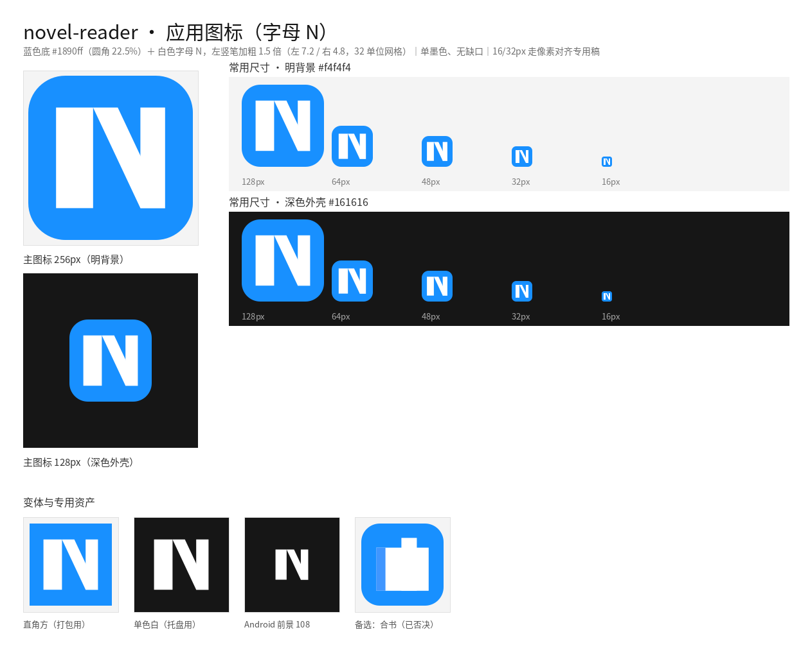

# novel-reader 应用图标（字母 N）

> 设计与资产说明。**本目录是图标设计的唯一事实来源；应用侧已按 §7 接入**
> （桌面窗口图标、Linux 打包、Android 启动图标、Windows 随包 .ico），图标二进制不在应用树内重复维护。
> 预览：`preview.png`（明/暗背景全尺寸一览）



---

## 1. 设计概念

**字母 N** —— 蓝底上的白色字母，**左竖笔加粗 1.5 倍**（按主人口径）。左笔兼作「书脊」意象：
一眼是品牌字母，细看「左重右轻」的笔画节奏又带出书脊的暗示。

| 项 | 取值 | 说明 |
|---|---|---|
| 底色 | `#1890ff` | 与桌面端设计系统 Primary 一致；圆角 22.5%，桌面与移动通用 |
| 字母色 | `#ffffff` | 单墨色，无缺口、无细碎细节 |
| 左竖笔 | `7.2` 单位 | = 4.8 × **1.5** |
| 右竖笔 / 斜笔 | `4.8` 单位 | 标准笔画 |
| 网格 | 32 × 32 单位（`viewBox 0 0 32 32`） | 2 的幂缩放友好 |
| 圆角 | `rx = 7.2`（22.5%） | 直角版本见 `-square` |

**精确几何**（32 网格；水平边距 5.4、垂直边距 6.2，居中）：

```
左竖笔： rect x=5.4  y=6.2  w=7.2 h=19.6
右竖笔： rect x=21.8 y=6.2  w=4.8 h=19.6
斜笔  ： M12.6 6.2 H17.4 L26.6 25.8 H21.8 Z
```

小尺寸专用稿（`svg/novel-reader-icon-small.svg`，全偶整数 —— 16px 为 0.5 倍、32px 为 1 倍，边缘均落整像素）：

```
左竖笔： rect x=6  y=6 w=6 h=20
右竖笔： rect x=22 y=6 w=4 h=20        # 6 : 4 = 1.5
斜笔  ： M12 6 H16 L26 26 H22 Z
```

---

## 2. 设计沿革（三轮收敛，均按主人复核意见）

| 轮次 | 方案 | 主人复核 | 结论 |
|---|---|---|---|
| 一 | **开卷**：两页对称、中缝通高收尖 | 「看起来是书裂开了」 | 判断准确：中缝贯通收尖即裂缝，两页外缘等高无透视 → 读作「被劈开的板」。实测 9 种改造（实底、短槽、浅折、曲顶页、透视页、抬页阶…）都无法在 32px 以下摆脱「缝」的歧义 |
| 二 | **书签书**：合书 + 中蓝书脊 + 顶书签 | 「看起来像电池了」 | 判断准确：矩形主体 + 顶部小凸起 = 电池同形。作废，仅留档为 `-alt-book` |
| 三 | **字母 N**（左竖笔 ×1.5） | 本轮采用 | 语义由品牌字母承担；左笔加粗同时给出「书脊」暗示，且笔画结构在 16px 最稳 |

「加粗左竖线」的两种理解都做了实测对照，最终采用**二者合一**：

| 方案 | 做法 | 实测 |
|---|---|---|
| N4 | 只加粗字母左侧的独立装饰竖线（4.4 → 6.6），字母不变 | 形成「双左竖」，元素割裂，16px 易并糊 |
| N5 | 只加粗字母自身左笔（4.8 → 7.2），保留 4.4 装饰线 | 细装饰线在 16px 丢失或成杂点 |
| **N3（采用）** | 把左侧装饰竖线**并入字母左笔**，合成一条加粗左竖（7.2） | 只有一条粗左竖，整洁、识别度高，16/32px 最稳 |

---

## 3. 文件清单

### 源矢量（`svg/`，7 个）

| 文件 | 用途 |
|---|---|
| `novel-reader-icon.svg` | **主图标**：圆角方（桌面 + 移动通用） |
| `novel-reader-icon-square.svg` | 直角方：Carbon/IBM 口径，用于 Linux/Windows 打包 |
| `novel-reader-icon-small.svg` | 小尺寸像素对齐专用（16px 与 32px 共用；偶整数坐标） |
| `novel-reader-icon-mono.svg` | 单色（透明底，`currentColor`，可直接内联着色/染色） |
| `novel-reader-icon-mono-white.svg` | 单色白（透明底，深色外壳/系统托盘） |
| `novel-reader-icon-adaptive-foreground.svg` | Android 自适应图标前景层（108dp 画布，内容收在 66dp 安全圈内） |
| `novel-reader-icon-alt-book.svg` | 备选留档：合书 + 书签（主人已否决为主图标，见 §2） |

### 位图（`png/`，35 个）

| 名称 | 尺寸 | 用途 |
|---|---|---|
| `novel-reader-icon-{16,32,48,64,128,256,512}.png` | 主图标全尺寸 | 16/32 由 `-small` 生成 |
| `novel-reader-icon-square-{16,32,48,64,128,256,512}.png` | 直角方全尺寸 | Linux/Windows 打包 |
| `novel-reader-icon-mono-{32,48,128}.png` | 单色黑（透明底） | 明色外壳、印刷 |
| `novel-reader-icon-mono-white-{32,48,128}.png` | 单色白（透明底） | 深色外壳、托盘 |
| `novel-reader-icon-alt-book-{16,32,48,64,128}.png` | 备选留档 | 合书方案（已否决） |
| `novel-reader-icon-android-{48,72,96,144,192}.png` | Android 传统启动图标 | mdpi / hdpi / xhdpi / xxhdpi / xxxhdpi |
| `novel-reader-icon-adaptive-foreground-{108,162,216,324,432}.png` | Android 自适应前景 | 同上五档密度（108dp 换算） |

### 其他

| 文件 | 说明 |
|---|---|
| `novel-reader.ico` | Windows 图标，含 16/32/48/64/128/256 六层；**每层单独用 cairo 渲染**（16/32 用像素对齐源），非二次缩放 |
| `preview.png` | 明/暗背景全尺寸一览 |

---

## 4. 尺寸对照

| 尺寸 | 典型落点 |
|---|---|
| 16 | 窗口标题栏、系统托盘、列表小图标（用 `-small`） |
| 32 | 任务栏/程序坞、GNOME 应用菜单（用 `-small`） |
| 48 | Windows 中图标、Android mdpi 启动图标 |
| 64 | 中等图标视图、Android hdpi |
| 128 | 桌面图标视图、Android xxhdpi、商店图 |
| 256 / 512 | 打包与商店（Linux `hicolor` 大尺寸、Windows ICO 最大层、应用商店） |

---

## 5. 各平台落点（接入时照此放置）

### Linux（当前交付平台）

```ini
# share/applications/novel-reader.desktop
Icon=novel-reader
```

```sh
# 图标安装口径（hicolor 主题）
share/icons/hicolor/{16x16,32x32,48x48,64x64,128x128,256x256}/apps/novel-reader.png
share/icons/hicolor/scalable/apps/novel-reader.svg      # = svg/novel-reader-icon.svg
```

现有 `desktop/packaging/linux/package-linux.sh` 目前**未安装任何图标**（`.desktop` 也没有 `Icon=` 行）——
接入属于打包脚本改动，需另行授权。

### Windows

现有脚本（`package-windows.ps1` / `package-windows-gnu.sh`）未引用图标。接入点：

- 可执行文件资源：用 `novel-reader.ico`（MSVC 路径可加 `.rc` + `WINDRES`；gnu 路径可用 `windres`）；
- 安装/快捷方式：同一 `.ico`。

### Android

```text
app/src/main/res/mipmap-mdpi/ic_launcher.png      ← png/novel-reader-icon-android-48.png
app/src/main/res/mipmap-hdpi/ic_launcher.png      ← …-72.png
app/src/main/res/mipmap-xhdpi/ic_launcher.png     ← …-96.png
app/src/main/res/mipmap-xxhdpi/ic_launcher.png    ← …-144.png
app/src/main/res/mipmap-xxxhdpi/ic_launcher.png   ← …-192.png

# Android 8.0+ 自适应图标
app/src/main/res/mipmap-anydpi-v26/ic_launcher.xml
    <adaptive-icon>
      <background android:drawable="@color/ic_launcher_background"/>   <!-- #1890ff 纯色 -->
      <foreground android:drawable="@mipmap/ic_launcher_foreground"/>  <!-- 前景 PNG -->
      <monochrome android:drawable="@mipmap/ic_launcher_monochrome"/>  <!-- 13+ 主题图标：单色版 -->
    </adaptive-icon>
app/src/main/res/mipmap-{m,h,xh,xxh,xxxh}dpi/ic_launcher_foreground.png
    ← png/novel-reader-icon-adaptive-foreground-{108,162,216,324,432}.png
```

`AndroidManifest.xml` 目前没有 `android:icon`（用系统默认图标），接入时补 `android:icon="@mipmap/ic_launcher"`。
自适应前景按 66dp 安全圈缩放（系数 2.4），圆/方/圆角方遮罩下主体都不会被裁。

### 应用窗口图标（Slint）

Slint 窗口图标由后端从可执行文件/桌面项读取；若需显式设置，可用 `32/48/128` 的 PNG 或 `novel-reader.ico`。

---

## 6. 复现与校验

```bash
# 矢量 → 位图（要求 rsvg-convert；逐尺寸直接渲染，不做二次缩放）
rsvg-convert -w 128 -h 128 svg/novel-reader-icon.svg -o png/novel-reader-icon-128.png

# 16/32px 请改用像素对齐源
rsvg-convert -w 16 -h 16 svg/novel-reader-icon-small.svg -o png/novel-reader-icon-16.png
```

已校验：7 个 SVG 均为合法 XML（`ElementTree` 解析通过）；35 个 PNG 尺寸与文件名一致；
单色/前景 PNG 带透明通道；`novel-reader.ico` 可解析且含 6 个尺寸层。
16px 实测笔画：左竖笔 3px（`x=3..5`）、斜笔 1px、右竖笔 2px（`x=11..12`）—— 比例符合 1.5。

---

## 7. 接入记录（应用侧）

| 落点 | 改动 | 说明 |
|---|---|---|
| 桌面窗口图标 | `desktop/ui/app.slint` 的 `AppWindow.icon: @image-url("../assets/icons/novel-reader-256.png")` | 编译期内嵌；副本与刷新口径见 `desktop/assets/icons/README.md` |
| Linux 打包 | `desktop/packaging/linux/package-linux.sh`：安装 hicolor 6 尺寸 PNG + scalable SVG，`.desktop` 增 `Icon=novel-reader`，并把图标列入发布目录自检；`desktop/packaging/targets.json` 同步 `release_layout` 与 `script_tokens` | 图标源一律取本目录（缺项时脚本 `exit 2`） |
| Android | `AndroidManifest.xml` 增 `android:icon` / `android:roundIcon`；`res/mipmap-*/` 传统 PNG + `ic_launcher_foreground/monochrome`；`res/mipmap-anydpi-v26/ic_launcher{,_round}.xml` 自适应图标；`res/values/colors.xml` 的 `ic_launcher_background` | 前景已按 66dp 安全圈缩放（系数 2.4）；单色层供 Android 13+ 主题图标 |
| Windows | 两个打包脚本随包分发 `novel-reader.ico`；`targets.json` 的 `release_layout` 登记该项并把「exe 内嵌图标」列入 `unverified_items` | **exe 资源图标未做**（需 rc.exe / windres 资源编译，本机无 Windows 工具链，未实测） |

口径：图标二进制**只在 `docs/design/icon/` 维护**，应用侧只做复制/内嵌；`.desktop` 的 `Icon=` 写不带扩展名的
`novel-reader`，由桌面环境按 hicolor 主题挑尺寸。
